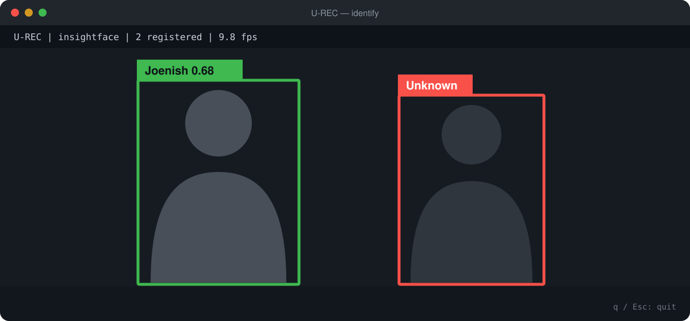
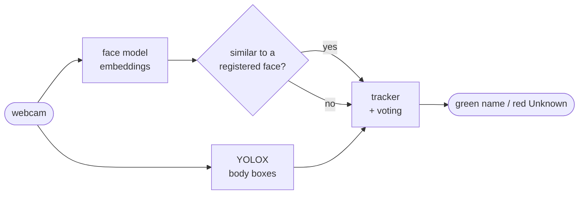

<p align="center">
  <picture>
    <source media="(prefers-color-scheme: dark)" srcset="docs/banner-dark.svg">
    
  </picture>
</p>

<p align="center">
  Known people get a <b>green box</b> with their name. Everyone else is <b>Unknown</b>.
</p>

<p align="center">
  
  
  
  
</p>

<p align="center">
  
</p>

---

## Quick start

```bash
git clone https://github.com/Joenish2006/U-REC && cd U-REC
./setup.sh --insightface          # one time   ·  Windows: setup.bat --insightface
./run.sh register YourName        # face scan  ·  Windows: run.bat register YourName
./run.sh identify                 # go live    ·  Windows: run.bat identify
```

Run `./run.sh` with no arguments for an interactive menu.

## Features

- **Whole-body boxes.** Green with a name for registered people, red "Unknown" for everyone else.
- **Face ID-style registration.** A guided scan (straight, turn, tilt) with blur and pose checks.
- **Stable labels.** Each person is tracked between frames and the name is decided by vote.
- **Swappable model.** A free OpenCV backend, or InsightFace for the best accuracy.
- **Private by design.** It stores embeddings only, never photos, and the web view is localhost only.
- **Runs anywhere.** Linux and Windows, CPU or NVIDIA GPU, with one setup script each.

## Commands

| Command | |
|---|---|
| `identify` | live recognition window · `--web` streams to `localhost:5000` |
| `register NAME` | guided face scan |
| `list` · `delete NAME` · `reset` | manage registered people |
| `info` | backend, threshold, device, file paths |
| `--camera N` | use another webcam (goes before the command) |

## How it works



Each face becomes an **embedding**, a list of 128 or 512 numbers. A face counts as a
registered person when its similarity to their stored embeddings reaches the threshold.
Otherwise it's Unknown.

| Backend | Models | Accuracy | Licence |
|---|---|---|---|
| `opencv` · default | YuNet + SFace | good | MIT / Apache-2.0 |
| `insightface` | SCRFD + ArcFace `buffalo_l` | best | non-commercial models |

<details>
<summary><b>Configuration</b></summary>
<br>

`setup` creates `config.toml` (gitignored) from [`config.example.toml`](config.example.toml).
The settings you're most likely to change:

| Setting | Default | Effect |
|---|---|---|
| `recognition.backend` | `opencv` | `insightface` for the best accuracy |
| `recognition.threshold_*` | `0.42` / `0.45` | higher means fewer wrong names and more Unknown |
| `bodies.model` | `yolox_s` | `yolox_tiny` is faster, `yolox_m` more accurate |
| `identify.recognize_every` | `2` | recognise faces every N frames |
| `register.min_sharpness` | `25` | blur check, lower it for soft webcams |

</details>

<details>
<summary><b>Troubleshooting</b></summary>
<br>

| Problem | Fix |
|---|---|
| `Could not open camera` | Close other apps using the webcam, or try `--camera 1` |
| `Permission denied` on `./run.sh` | `chmod +x run.sh setup.sh` |
| `Only N good frames` | It prints the reason. For `blurry`, hold still in better light or lower `min_sharpness` |
| Strangers get a name | Raise `threshold_*` |
| Registered person stays Unknown | Lower `threshold_*` a little, or register again in better light |
| Low fps | `yolox_tiny`, `buffalo_s`, `recognize_every = 3` |
| `CERTIFICATE_VERIFY_FAILED` | The network intercepts HTTPS (campus Wi-Fi). Run setup once on a hotspot |
| Switched backend, everyone Unknown | Each backend keeps its own data, so register people again |
| InsightFace install fails on Windows | Install [VS Build Tools](https://visualstudio.microsoft.com/visual-cpp-build-tools/) → *Desktop development with C++* |

</details>

<details>
<summary><b>Manual setup (no scripts)</b></summary>
<br>

```bash
python -m venv .venv
source .venv/bin/activate              # Windows: .venv\Scripts\activate
pip install -r requirements.txt        # + requirements-insightface.txt
python cli.py init
python cli.py download-models
python cli.py
```

</details>

<details>
<summary><b>Project structure</b></summary>
<br>

```
cli.py                 menu and commands
urec/
  embedder.py          face detection + embeddings (OpenCV / InsightFace)
  matcher.py           name or Unknown
  register.py          guided face scan
  bodies.py            YOLOX body detection
  tracker.py           tracking + vote smoothing
  identify.py          live loop
  web.py               localhost stream
  database.py          SQLite, embeddings only
  config.py · models.py · runtime.py · camera.py · ui.py
tests/                 python -m unittest  (no camera needed)
```

</details>

## Privacy

Only embeddings are stored, in `data/urec.db`. Photos, the database, models and
`config.toml` are gitignored. Register only people who agreed to it. A normal webcam
is 2D, so a printed photo could fool it; liveness detection is future work.

## Licence

The code is [MIT](LICENSE). Models download at runtime and keep their own licences:
YuNet (MIT), SFace (Apache-2.0), YOLOX (Apache-2.0). **InsightFace's pretrained
models are for non-commercial research only**, so use the `opencv` backend for
commercial work.

## Team

Built by **Team Rocognance**, B.Tech Robotics and Automation, Lovely Professional University.

| | Focus |
|---|---|
| **Joenish** | lead · recognition core |
| **Nishanth** | face registration |
| **Sathish** | live view · body detection · tracking |
| **Omkar** | CLI · web view · launchers |
| **Thanigai** | database · testing |
